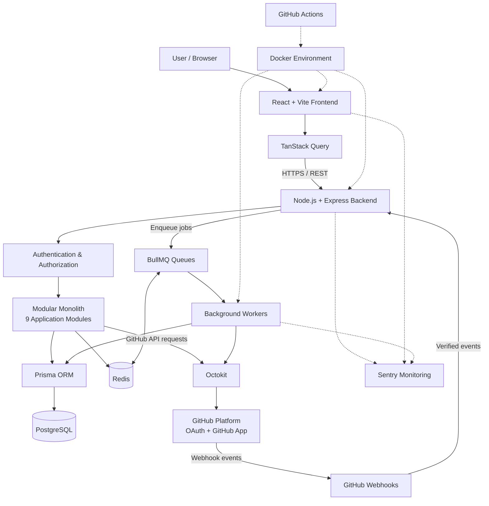

# DevCollab — System Architecture Design

## 1. Introduction

DevCollab is a GitHub-powered collaboration and developer analytics platform for individual developers, development teams, maintainers, and open-source contributors.

This document defines how the frontend, backend, database, and GitHub integration will communicate.

## 2. Architecture Pattern — Modular Monolith

DevCollab will use a **Modular Monolith Architecture**.

The backend will run as one application, but its code will be divided into independent modules based on responsibilities.

### Why Modular Monolith?

- Easier to develop, understand, and maintain.
- Modules have clearly separated responsibilities.
- Modules can communicate directly within the backend.
- Less infrastructure complexity than microservices.
- Can support future growth without introducing distributed-system complexity too early.

We will not use microservices in the initial architecture.

## 3. System Components

| Component | Technology | Responsibility |
|---|---|---|
| Frontend | React + JavaScript + Vite | User interface |
| API State Management | TanStack Query | API requests, caching, and server state |
| Backend | Node.js + Express.js | API handling and business logic |
| Database | PostgreSQL | Persistent application data |
| ORM | Prisma | Database access and queries |
| Cache | Redis | Temporary cached data and queue storage |
| Background Jobs | BullMQ | Asynchronous task processing |
| GitHub Integration | Octokit | GitHub API communication |
| Authentication | GitHub OAuth | User identity and login |
| Repository Authorization | GitHub App | Repository access and permissions |
| Event Integration | GitHub Webhooks | Receiving GitHub events |
| Monitoring | Sentry | Error monitoring |
| Containerization | Docker | Consistent application environments |
| CI/CD | GitHub Actions | Automated workflows |

## 4. Backend Modules

The Express backend will be organized into nine major application modules:

1. Authentication Module
2. Repository Management Module
3. Issue Explorer Module
4. Pull Request Management Module
5. Analytics Module
6. Contributor Insights Module
7. Notifications Module
8. Synchronization Module
9. Admin and Settings Module

Each module will have a clearly defined responsibility.

## 5. Component Communication

### Frontend to Backend

- React will display the user interface.
- TanStack Query will manage API requests and server state.
- The frontend will communicate with the backend through HTTPS REST APIs.
- The frontend will never directly access PostgreSQL or Redis.
- GitHub access tokens and sensitive credentials will remain on the server.

### Backend to Database

- Express will handle application requests and business logic.
- Prisma will provide the database access layer.
- PostgreSQL will store persistent application data.
- Only authorized backend modules will access the database through Prisma.

### Backend to GitHub

- Octokit will communicate with GitHub REST and GraphQL APIs.
- GitHub OAuth will authenticate users.
- GitHub App installations will provide repository-level access.
- GitHub remains the source of truth for GitHub-native information such as issues, pull requests, branches, and repository permissions.

## 6. Database Architecture

PostgreSQL will be the primary persistent database.

It will store application-specific information, including:

- User profiles and account information.
- Workspace and team information.
- Application-level membership and settings.
- Repository connection and synchronization metadata.
- Selected GitHub activity data needed for analytics.
- Notifications and other application records.

DevCollab will not unnecessarily duplicate all GitHub data. GitHub will remain the authoritative source for GitHub-native records and permissions.

Prisma will manage database queries and schema definitions.

## 7. Cache and Background Processing

### Redis

Redis will be used for:

- Temporary caching.
- Session-related storage where required.
- BullMQ queue storage.

Redis will not be treated as the primary permanent database.

### BullMQ

BullMQ will handle time-consuming background operations, such as:

- Initial repository synchronization.
- Repository data updates.
- Issue and pull request synchronization.
- Analytics data processing.
- Webhook-triggered background tasks.

Background workers will process queued jobs using Octokit and Prisma.

Jobs should support retries and idempotent processing to reduce duplicate or inconsistent updates.

## 8. GitHub Integration Architecture

DevCollab will use multiple GitHub integration mechanisms.

| Technology | Purpose |
|---|---|
| GitHub OAuth | Authenticate users and establish their identity |
| GitHub App | Authorize repository access through installation permissions |
| GitHub REST API | Retrieve and interact with supported GitHub resources |
| GitHub GraphQL API | Retrieve related GitHub data efficiently |
| GitHub Webhooks | Receive notifications about GitHub events |
| Octokit | Communicate with GitHub APIs from the backend |

GitHub OAuth and GitHub App serve different purposes. OAuth establishes the user's identity, while the GitHub App provides repository access according to its granted permissions.

DevCollab will respect GitHub's permission model.

## 9. Repository Connection Workflow

1. A user signs in using GitHub OAuth.
2. The user installs or authorizes the DevCollab GitHub App.
3. The user selects the repositories they want to connect.
4. The backend validates the user's identity and relevant access permissions.
5. The backend schedules initial synchronization jobs through BullMQ.
6. Background workers retrieve the required information using Octokit.
7. Selected data is stored in PostgreSQL through Prisma.
8. The frontend retrieves the processed data through backend APIs.
9. Future GitHub events are received through webhooks and processed to keep information updated.

## 10. Webhook Processing

GitHub Webhooks will notify DevCollab about relevant repository events.

The backend will:

1. Receive webhook events.
2. Verify webhook signatures.
3. Identify the event type.
4. Validate and process the event.
5. Schedule background work when necessary.
6. Update relevant application data.

Webhook processing will use background jobs for operations that do not need to finish during the initial request.

## 11. Monitoring and Deployment Architecture

- Sentry will monitor errors from the frontend, backend, and background workers.
- Docker will provide consistent environments for application services.
- GitHub Actions will automate CI/CD workflows.
- Deployment will use AWS or another suitable cloud platform.

Sensitive credentials and tokens must not be exposed in logs or monitoring events.

## 12. System Architecture Diagram

## 13. Architecture Decisions and Rules

1. DevCollab will use a Modular Monolith architecture.
2. The frontend will communicate with the backend through REST APIs.
3. The frontend will never directly access the database.
4. PostgreSQL will be the primary persistent database.
5. Prisma will manage database access.
6. Redis will handle caching and background queue storage.
7. BullMQ will process asynchronous tasks.
8. Octokit will handle GitHub API communication.
9. GitHub OAuth will handle user authentication.
10. GitHub App will manage repository-level authorization.
11. GitHub will remain the source of truth for GitHub-native data and permissions.
12. Webhook events will be verified before processing.
13. Background jobs should support retries and idempotency.
14. Sensitive credentials and tokens will remain on the backend.
15. DevCollab will store only the GitHub data necessary for its application features.
16. AI-generated recommendations must be explainable and based on observable data.
17. AI will not independently perform consequential GitHub actions such as approving or merging pull requests.

## 14. Conclusion

The proposed architecture provides DevCollab with a clear separation of responsibilities between its frontend, backend, database, and GitHub integration.

The Modular Monolith approach keeps the initial system manageable while allowing individual modules to evolve as the platform grows.

This architecture will serve as the technical foundation for the remaining Phase 3 planning activities.