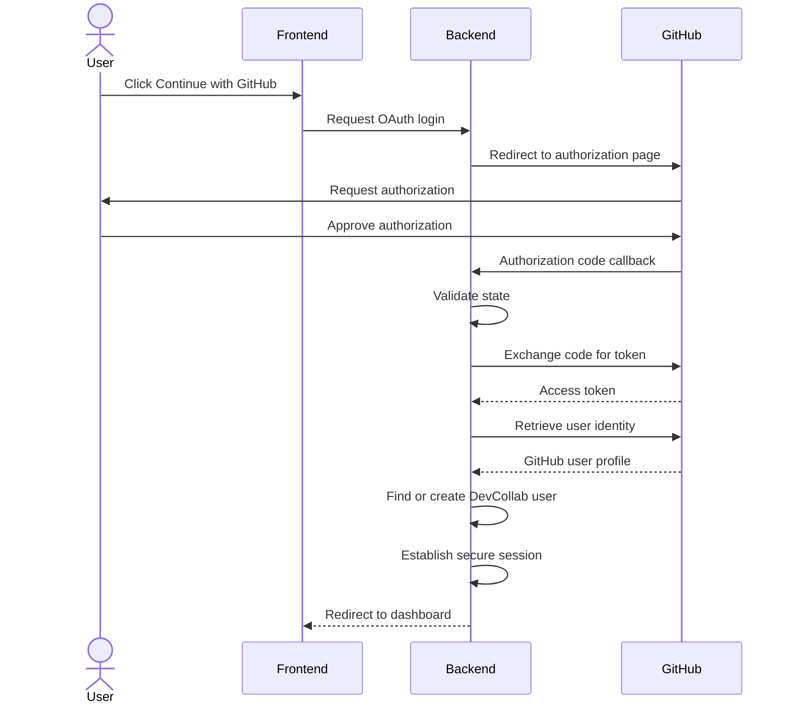
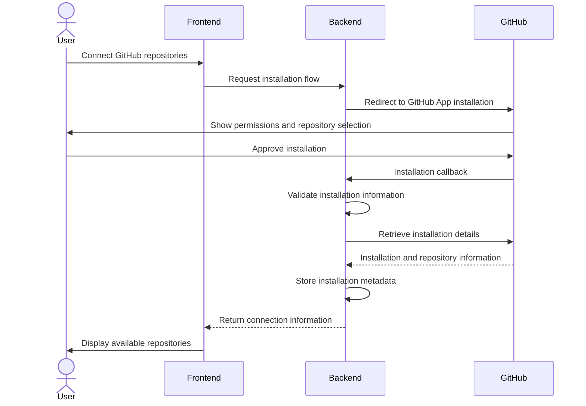

# DevCollab — Authentication Architecture

## 1. Introduction

DevCollab will use GitHub as its primary identity provider.

Authentication and repository authorization will be handled separately using:

- **GitHub OAuth:** User login and identity verification.
- **GitHub App:** Repository access and permission management.

This separation ensures that signing into DevCollab does not automatically grant access to every GitHub repository.

## 2. Authentication vs Authorization

| Concept | Meaning | DevCollab Technology |
|---|---|---|
| Authentication | Verifies who the user is | GitHub OAuth |
| Authorization | Determines what the user can access or perform | DevCollab roles and GitHub App permissions |

For example:

A user can successfully sign in to DevCollab but may not have permission to access a particular private GitHub repository.

## 3. GitHub OAuth Architecture

GitHub OAuth will handle user authentication.

### Login Workflow

1. User clicks **Continue with GitHub**.
2. Frontend redirects the user to the backend authentication endpoint.
3. Backend redirects the user to GitHub's authorization page.
4. User reviews and authorizes the requested OAuth permissions.
5. GitHub redirects the user to the backend callback URL with an authorization code.
6. Backend validates the OAuth state and exchanges the authorization code for an access token.
7. Backend retrieves the user's GitHub identity.
8. Backend finds or creates the corresponding DevCollab user and linked GitHub account.
9. Backend establishes a secure authenticated session.
10. User is redirected to the DevCollab dashboard.

### OAuth Flow Diagram

## 4. GitHub OAuth Security

The following security measures will be followed:

- Use HTTPS for authentication communication.
- Use OAuth state validation to protect against CSRF attacks.
- Request only the minimum required OAuth permissions.
- Keep OAuth client secrets on the backend.
- Never expose access tokens in frontend JavaScript.
- Encrypt stored OAuth tokens when persistence is necessary.
- Use secure, HttpOnly, and appropriate SameSite session cookies.
- Support session expiration and logout.
- Avoid logging access tokens or sensitive authentication information.

OAuth access tokens will not be treated as proof of repository authorization.

## 5. Session Management

DevCollab will use secure server-managed sessions.

### Session Workflow

1. User completes GitHub OAuth authentication.
2. Backend creates an authenticated session.
3. A secure session cookie is sent to the browser.
4. Browser automatically sends the cookie with eligible API requests.
5. Backend validates the session before processing protected requests.
6. Logout invalidates the session.

Session storage may use Redis.

The browser must not store GitHub access tokens or session secrets in localStorage.

## 6. GitHub App Architecture

GitHub App will manage access to repositories.

Users or organizations will install the DevCollab GitHub App and select the repositories they want DevCollab to access.

### GitHub App Workflow

1. User signs into DevCollab.
2. User selects the option to connect GitHub repositories.
3. Backend initiates the GitHub App installation flow.
4. GitHub displays installation permissions.
5. User or organization administrator installs the application.
6. GitHub redirects the user to the configured callback.
7. Backend identifies the GitHub App installation.
8. Backend records the installation information.
9. Backend retrieves authorized repository information using installation credentials.
10. User selects repositories to connect to a workspace.

### GitHub App Flow Diagram

## 7. GitHub App Permissions

DevCollab will request only permissions needed for its approved features.

The exact permission configuration will be finalized during GitHub App setup.

Planned permission considerations:

| GitHub Resource | Purpose |
|---|---|
| Repository metadata | Identify connected repositories |
| Issues | Retrieve issue information |
| Pull requests | Retrieve pull request information |
| Commit and related activity data | Support contribution analytics |
| Webhook events | Receive relevant repository updates |

Read-only access will be preferred wherever possible.

Write permissions will only be requested if a finalized feature genuinely requires them.

## 8. Authentication and Authorization Layers

DevCollab will use multiple authorization layers.

### Layer 1: Authentication

Checks whether a user has a valid DevCollab session.

### Layer 2: Platform Authorization

Checks platform-level roles.

Examples:

- Regular user
- Platform administrator

### Layer 3: Workspace Authorization

Checks whether the user belongs to a workspace and what workspace role they have.

Examples:

- Workspace owner
- Workspace member

### Layer 4: GitHub Repository Authorization

Checks whether the GitHub App installation has access to the requested repository and whether the requested operation is allowed by GitHub permissions.

A DevCollab workspace role must never override GitHub's repository permissions.

## 9. Role-Based Access Design

The six finalized application roles will be handled according to their scope.

| Role | Authorization Source |
|---|---|
| Individual Developer | Authenticated user and personal workspace ownership |
| Team Owner | Workspace membership role |
| Team Member | Workspace membership role |
| Repository Maintainer | GitHub repository permissions |
| Open-Source Contributor | Observable contribution activity |
| Platform Administrator | DevCollab platform-level role |

These roles are not all global user roles.

For example, a user may be a Team Owner in one workspace and a Team Member in another.

Repository Maintainer status must be based on actual GitHub permissions rather than a manually assigned DevCollab label.

## 10. Token Management

DevCollab may handle different credentials for different purposes.

| Credential | Purpose | Storage and Handling |
|---|---|---|
| OAuth access token | Access authorized GitHub user information | Server-side encrypted storage when needed |
| GitHub App private key | Authenticate the GitHub App | Secure backend secret storage |
| Installation access token | Access repositories authorized for an installation | Short-lived, server-side handling |
| Session identifier | Identify an authenticated DevCollab session | Secure HttpOnly cookie; session data server-side |

### Token Security Rules

1. Never expose GitHub tokens to the frontend.
2. Never commit credentials or private keys to Git.
3. Encrypt persistent OAuth tokens.
4. Generate installation access tokens when required.
5. Respect token expiration.
6. Avoid unnecessary token storage.
7. Never include secrets in application logs.
8. Revoke or invalidate credentials and sessions when appropriate.

## 11. Logout and Account Disconnection

### Logout

1. User requests logout.
2. Backend invalidates the current session.
3. Browser session cookie is cleared.
4. User is redirected to the login page.

### Disconnect GitHub Account

1. User requests account disconnection.
2. Backend checks whether the account can safely be disconnected.
3. Relevant OAuth credentials are revoked or invalidated where applicable.
4. Stored credentials are removed.
5. Linked account information is updated according to the account-retention policy.

Disconnecting a GitHub account does not automatically uninstall a GitHub App from an organization.

### Uninstall GitHub App

When an installation is removed from GitHub:

1. GitHub sends an installation-related webhook event.
2. Backend verifies the webhook signature.
3. Installation status is updated.
4. Associated repository access is marked unavailable.
5. Relevant synchronization jobs are stopped or adjusted.
6. Historical application data is retained or removed according to the data-retention policy.

## 12. Important Security Decisions

1. GitHub OAuth will be the primary authentication method.
2. GitHub App will handle repository-level authorization.
3. Authentication and authorization will remain separate.
4. Backend will manage sessions.
5. Secure HttpOnly cookies will be used for browser sessions.
6. GitHub tokens will remain server-side.
7. GitHub App permissions will be checked before repository operations.
8. Workspace roles will not override GitHub permissions.
9. Platform administrators will not automatically receive private repository access.
10. Only necessary permissions will be requested.
11. OAuth state validation and webhook signature verification are mandatory.
12. AI features will operate within the same authorization rules as other application features.

## 13. Conclusion

This authentication architecture separates user identity, application permissions, workspace access, and GitHub repository authorization.

GitHub OAuth will establish the user's identity, while GitHub App will provide controlled repository access.

This design will provide a secure foundation for DevCollab's collaboration and analytics features.