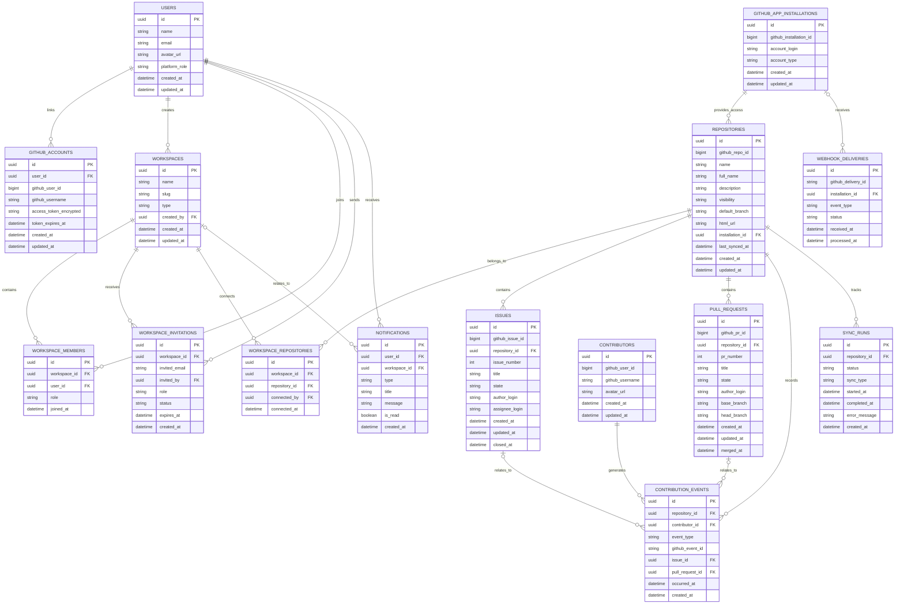

# DevCollab — Entity Relationship Diagram (ER Diagram)

## 1. Introduction

This document represents the database entities of DevCollab and the relationships between them.

The ER Diagram is based on the database planning document and represents how records will be connected in PostgreSQL.

## 2. ER Diagram

## 3. Relationship Summary

| Relationship | Type |
|---|---|
| User → GitHub Accounts | One-to-Many |
| User → Workspaces | One-to-Many |
| User → Workspace Members | One-to-Many |
| Workspace → Workspace Members | One-to-Many |
| Workspace → Workspace Invitations | One-to-Many |
| User → Workspace Invitations | One-to-Many |
| GitHub App Installation → Repositories | One-to-Many |
| Workspace → Workspace Repositories | One-to-Many |
| Repository → Workspace Repositories | One-to-Many |
| Repository → Issues | One-to-Many |
| Repository → Pull Requests | One-to-Many |
| Repository → Contribution Events | One-to-Many |
| Contributor → Contribution Events | One-to-Many |
| Issue → Contribution Events | One-to-Many |
| Pull Request → Contribution Events | One-to-Many |
| User → Notifications | One-to-Many |
| Workspace → Notifications | One-to-Many (optional workspace) |
| Repository → Sync Runs | One-to-Many |
| GitHub App Installation → Webhook Deliveries | One-to-Many (optional installation) |

## 4. Important Notes

1. `PK` means Primary Key: a field that uniquely identifies a record.
2. `FK` means Foreign Key: a field that references another entity.
3. Workspace Members connects users and workspaces.
4. Workspace Repositories connects workspaces and repositories.
5. A contributor can exist without having a DevCollab account.
6. Issue and Pull Request references in Contribution Events are optional.
7. A workspace can receive notifications, but some notifications may be personal and have no workspace.
8. GitHub remains the source of truth for GitHub-native information.

## 5. Conclusion

This ER Diagram provides a visual representation of DevCollab's planned database structure.

It will serve as the reference for creating the detailed Prisma database schema in the next step.