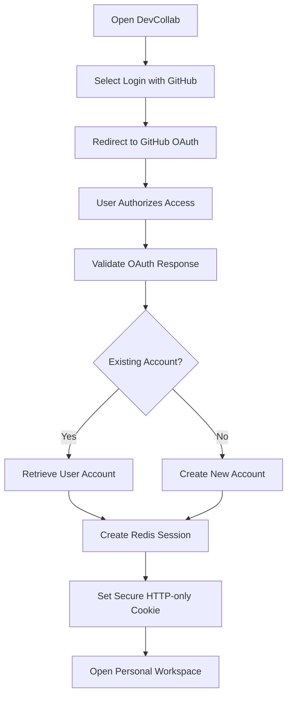
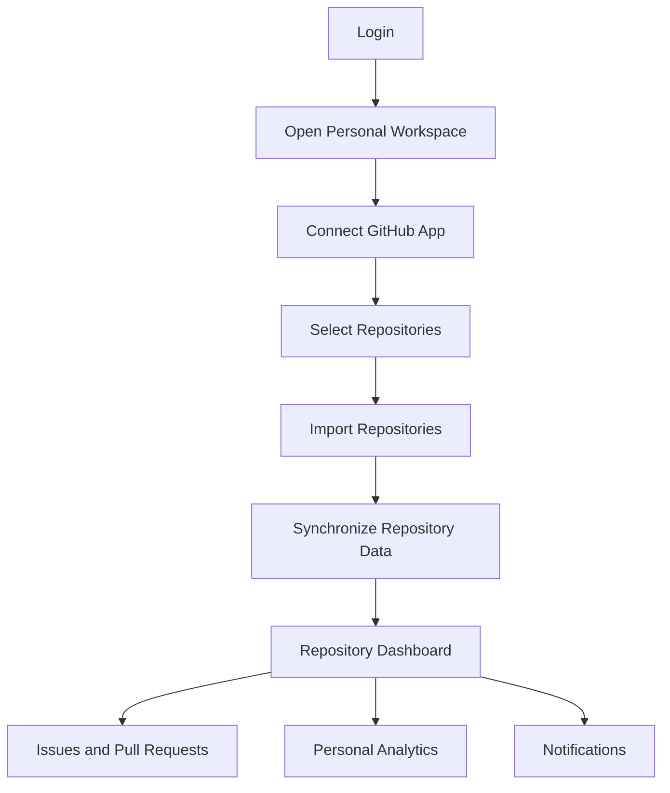
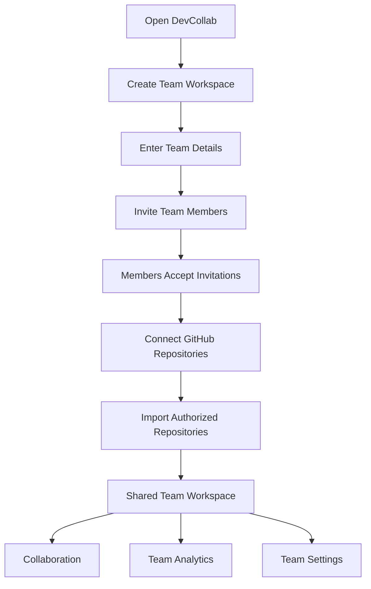
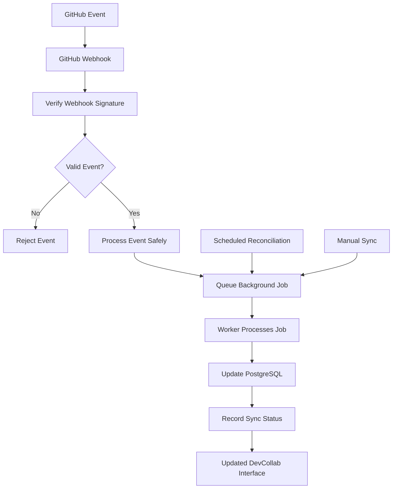
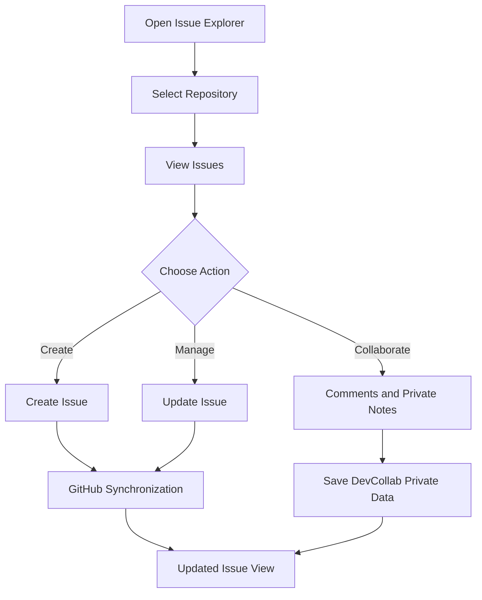
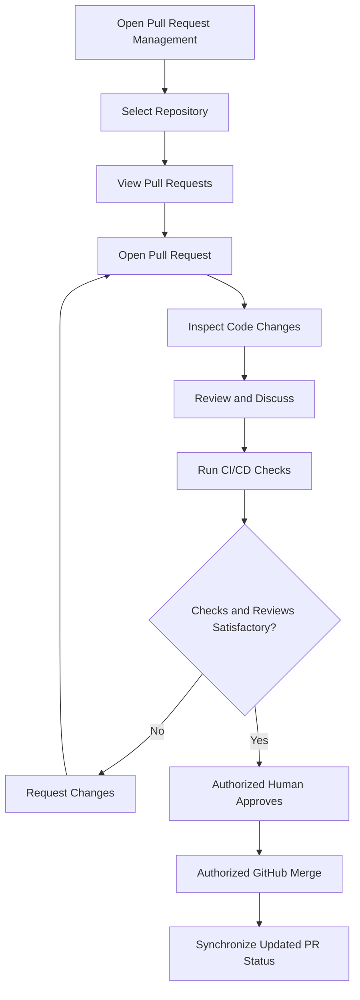
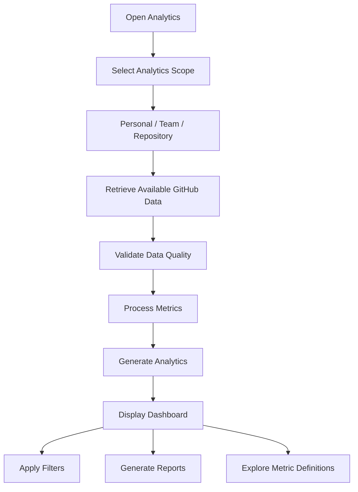
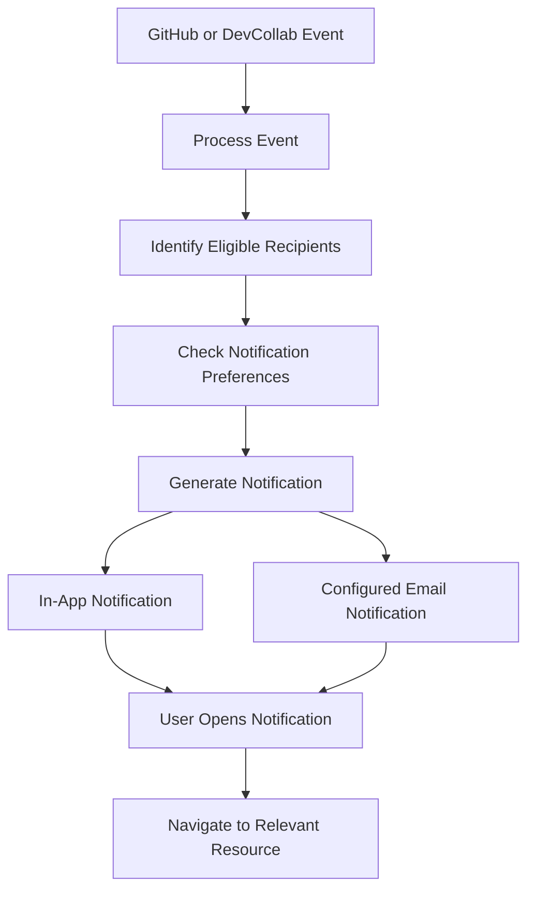
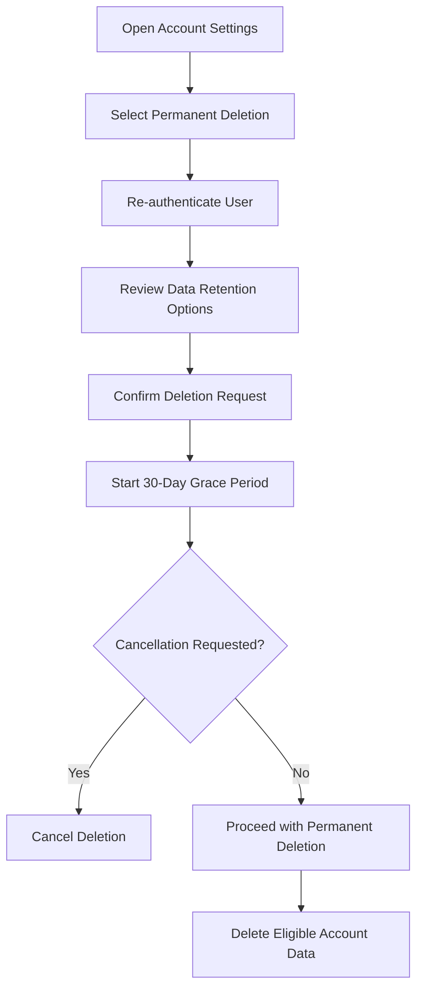
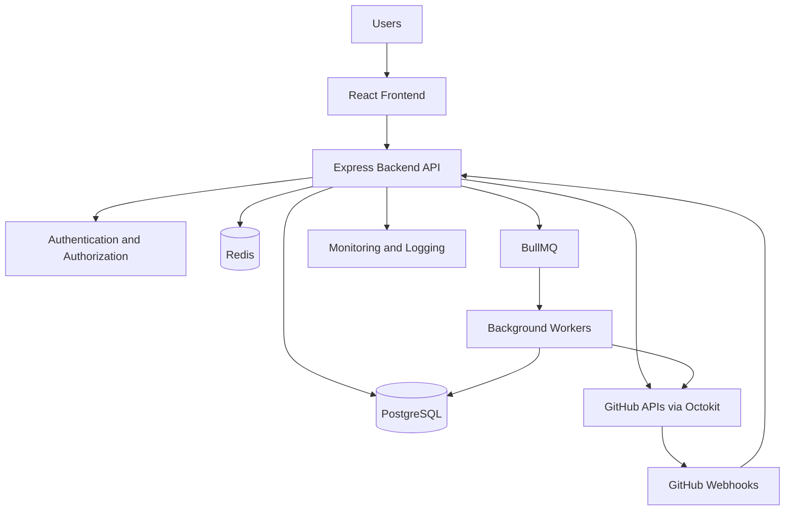

# DevCollab — Workflow Diagrams

These diagrams describe the primary user journeys and system workflows.

## 1. GitHub Authentication Workflow

## 2. Personal Workspace Workflow

## 3. Team Workspace Workflow

## 4. Repository Synchronization Workflow

## 5. Issue Management Workflow

## 6. Pull Request Workflow

## 7. Analytics Workflow

## 8. Notification Workflow

## 9. Account Deletion Workflow

## 10. Overall System Architecture

## Diagram Notes

- GitHub remains authoritative for GitHub-native resources and permissions.
- Redis manages server-side sessions and caching.
- PostgreSQL stores application data.
- BullMQ handles asynchronous background processing.
- GitHub Webhooks trigger event-driven synchronization.
- Private notes remain exclusive to DevCollab.
- AI suggestions require human review before consequential actions.
- All operations must respect the user's actual authorization.