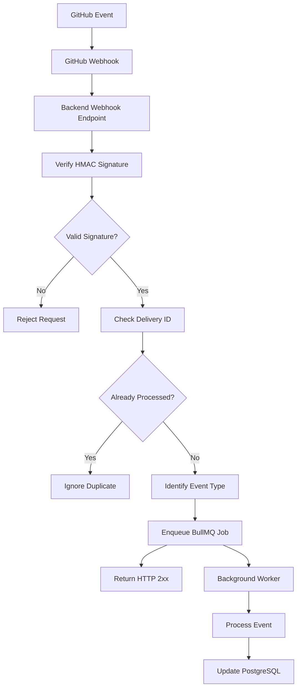
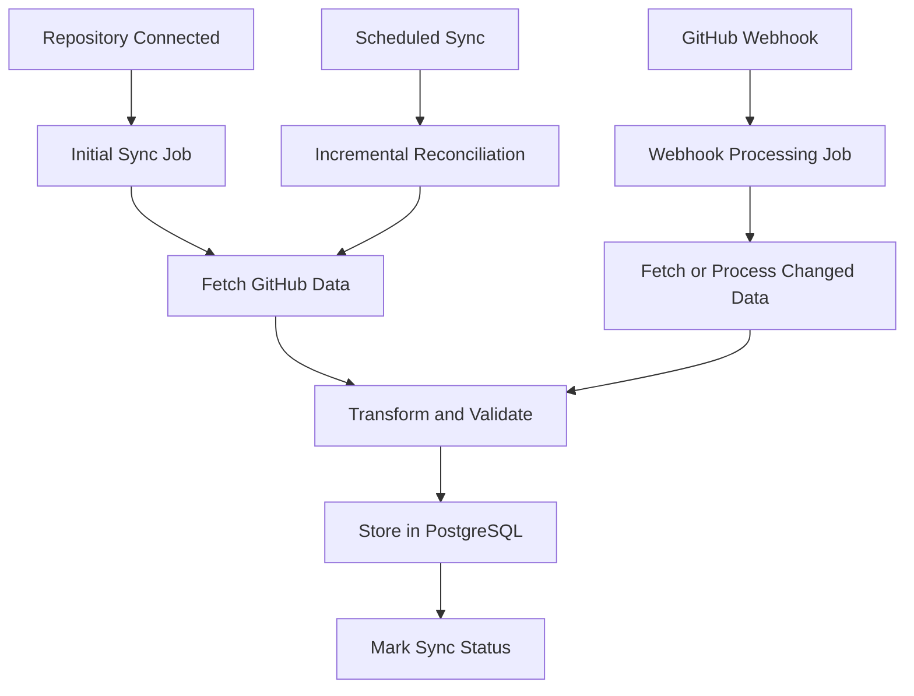
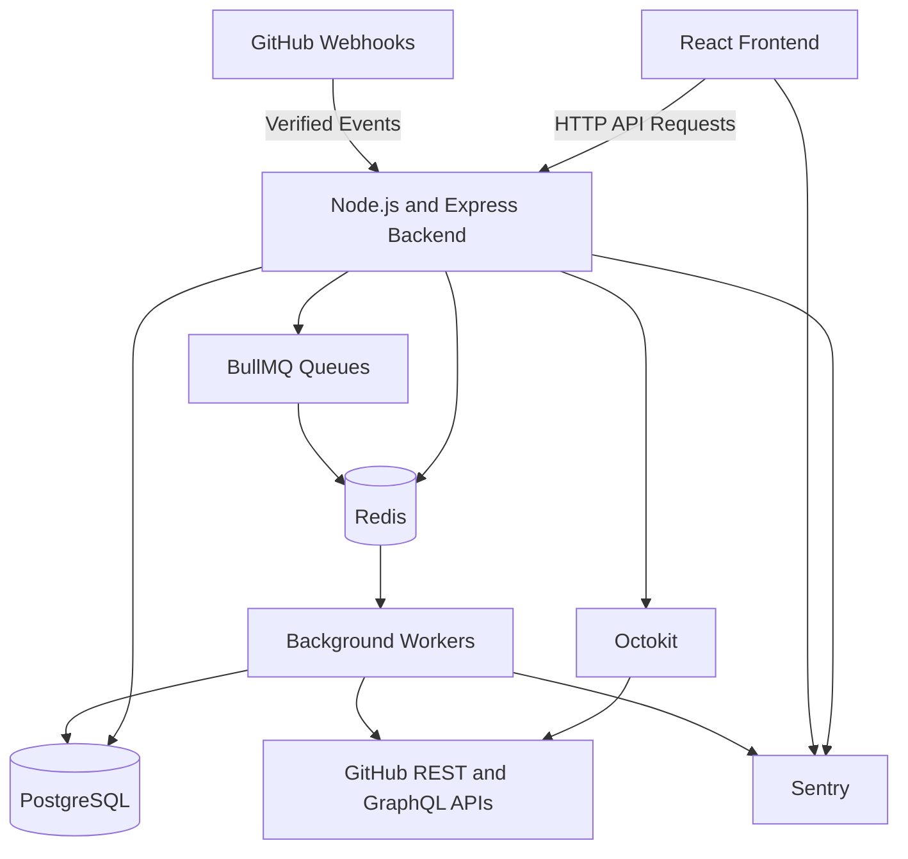

# DevCollab — Integration Architecture

## 1. Introduction

DevCollab integrates with external services to collect GitHub collaboration data, process background tasks, synchronize repository information, and monitor application health.

The main integrations are:

- GitHub REST API and GraphQL API
- GitHub Webhooks
- Octokit
- Redis
- BullMQ
- Sentry

All integrations will be managed through the backend.

## 2. GitHub API Integration

DevCollab will use GitHub APIs to retrieve repository and collaboration information.

### Technologies

| Technology | Purpose |
|---|---|
| Octokit | JavaScript library for communicating with GitHub APIs |
| GitHub REST API | Retrieve repositories, issues, pull requests and related information |
| GitHub GraphQL API | Retrieve selected nested or aggregated GitHub data efficiently |

### Integration Workflow

1. Backend receives a request for GitHub data.
2. Backend checks the user's DevCollab authorization.
3. Backend identifies the relevant GitHub App installation.
4. Backend obtains a valid installation access token.
5. Octokit sends the request to GitHub.
6. GitHub returns the requested data.
7. Backend validates and transforms the response.
8. Required application data is stored in PostgreSQL.
9. Backend returns the appropriate response to the frontend.

GitHub remains the source of truth for GitHub-native information.

DevCollab will store only the data needed for its features.

## 3. GitHub Webhook Integration

GitHub Webhooks will notify DevCollab when relevant repository events occur.

Examples include:

- Issues opened, edited, closed or reopened.
- Pull requests opened, updated, merged or closed.
- Repository changes.
- GitHub App installation and permission changes.

### Webhook Workflow

1. An event occurs on GitHub.
2. GitHub sends an HTTP POST request to the DevCollab webhook endpoint.
3. Backend verifies the webhook signature using HMAC SHA-256 and the raw request body.
4. Backend checks the unique GitHub delivery ID to prevent duplicate processing.
5. Backend identifies the event type.
6. Backend accepts the event and queues the required background job.
7. Backend returns a successful HTTP response promptly.
8. A background worker processes the event.
9. Relevant PostgreSQL records are created or updated.

### Webhook Architecture

### Webhook Security Rules

- Verify every webhook signature.
- Use the raw request body for signature verification.
- Store webhook secrets securely.
- Reject invalid signatures.
- Use delivery IDs for duplicate detection.
- Avoid processing the same event multiple times.
- Do not trust webhook payloads as authorization proof.
- Store only necessary event information.
- Keep webhook processing separate from the incoming HTTP request.

## 4. Redis Integration

Redis will provide fast temporary storage and support background job processing.

### Planned Responsibilities

| Use Case | Purpose |
|---|---|
| Session storage | Store server-managed session information |
| Caching | Temporarily cache frequently requested data |
| BullMQ backend | Support background job queues |
| Temporary state | Store short-lived operational information when required |

### Caching Strategy

Frequently requested information may be cached to reduce repeated GitHub API calls and database queries.

Examples:

- Repository summaries.
- Dashboard analytics.
- Frequently accessed workspace information.

Cache entries will have appropriate expiration times.

When underlying data changes, relevant cache entries will be invalidated or refreshed.

**Important:** Redis will not be the permanent source of truth. PostgreSQL will store persistent application data.

## 5. Background Job Processing

DevCollab will use BullMQ with Redis for asynchronous processing.

Not every operation should happen during an HTTP request.

Long-running operations will be moved to background workers.

### Planned Background Jobs

| Job | Purpose |
|---|---|
| Repository Sync | Synchronize repository information |
| Issue Sync | Retrieve and update issue information |
| Pull Request Sync | Retrieve and update pull request information |
| Contributor Processing | Update contributor-related information |
| Analytics Processing | Calculate analytics from stored data |
| Webhook Processing | Process incoming GitHub events |
| Notification Processing | Generate and deliver application notifications |

### Job Processing Workflow

1. Backend identifies a task that should run asynchronously.
2. Backend adds a job to the appropriate BullMQ queue.
3. Redis stores the queue information.
4. A worker picks up the job.
5. Worker processes the task.
6. Worker updates PostgreSQL when necessary.
7. Job is marked completed or failed.
8. Failed jobs follow the configured retry policy.

### Reliability Rules

- Configure retry limits.
- Use exponential backoff where appropriate.
- Make jobs idempotent so retries do not create duplicate results.
- Track job failures.
- Monitor repeatedly failing jobs.
- Define a failed-job recovery process.
- Avoid placing unnecessary sensitive information in job payloads.

## 6. Data Synchronization Architecture

DevCollab will use both webhook-driven updates and scheduled synchronization.

### Initial Synchronization

When a repository is connected:

1. Backend verifies installation access.
2. Repository information is retrieved.
3. Relevant issues and pull requests are synchronized.
4. Contributor and activity information is processed.
5. Records are stored in PostgreSQL.
6. Synchronization status is updated.

### Incremental Synchronization

After initial synchronization:

- Webhooks will trigger updates for supported GitHub events.
- Scheduled background jobs will periodically reconcile data.
- Only necessary changes will be fetched where possible.
- Pagination and GitHub API rate limits will be handled.
- Synchronization checkpoints will help resume interrupted work.

### Synchronization Flow

### Synchronization Rules

- GitHub remains the source of truth for GitHub-native information.
- Avoid unnecessary repeated API requests.
- Handle pagination.
- Respect GitHub API rate limits.
- Record synchronization status and timestamps.
- Handle partial failures without losing successful progress.
- Prevent duplicate records.
- Provide a way to retry failed synchronization.

## 7. GitHub API Rate Limit Handling

GitHub APIs have usage limits.

DevCollab will:

1. Monitor API rate-limit information.
2. Avoid unnecessary repeated requests.
3. Use pagination efficiently.
4. Prefer webhooks for event-driven updates.
5. Use caching for suitable frequently accessed data.
6. Retry requests when appropriate.
7. Respect GitHub's rate-limit reset information.
8. Track synchronization failures caused by rate limits.

The application should not assume that every GitHub API request will succeed immediately.

## 8. Sentry Integration

Sentry will be used for application error monitoring.

It will help identify:

- Backend exceptions.
- Frontend errors.
- Failed background jobs.
- Integration failures.
- Unexpected application behavior.

### Error Monitoring Workflow

1. An error occurs in DevCollab.
2. The relevant application component reports the error to Sentry.
3. Sentry records the error and relevant diagnostic context.
4. Developers investigate the issue.
5. The issue is fixed and verified.

### Security Rules

- Never send access tokens to Sentry.
- Never expose private keys or webhook secrets.
- Redact sensitive user information where appropriate.
- Avoid sending unnecessary GitHub payload data.
- Configure appropriate error reporting for production.

## 9. Integration Architecture Diagram

## 10. Integration Security and Reliability

The following rules will guide all external integrations:

1. All external API communication will be handled through the backend.
2. GitHub credentials will never be exposed to the frontend.
3. GitHub App installation permissions will be checked before repository operations.
4. Webhook signatures must be verified.
5. Duplicate webhook deliveries must not cause duplicate processing.
6. Background jobs must support retries and idempotent processing.
7. Redis will not replace PostgreSQL as persistent storage.
8. GitHub API rate limits must be respected.
9. Integration errors must be logged and monitored.
10. Sensitive information must be excluded from application logs.
11. Failed synchronization must be recoverable.
12. External service failures must not unnecessarily crash the entire application.

## 11. Final Integration Decisions

| Integration | Selected Technology |
|---|---|
| GitHub communication | Octokit |
| GitHub APIs | REST and GraphQL |
| Repository authorization | GitHub App |
| Event notifications | GitHub Webhooks |
| Temporary storage and caching | Redis |
| Background jobs | BullMQ |
| Persistent data | PostgreSQL |
| Error monitoring | Sentry |

## 12. Conclusion

This integration architecture defines how DevCollab communicates with GitHub and manages asynchronous processing.

GitHub APIs provide repository data, webhooks notify DevCollab about changes, BullMQ processes background tasks, Redis supports caching and queues, PostgreSQL stores persistent application data, and Sentry monitors application errors.

